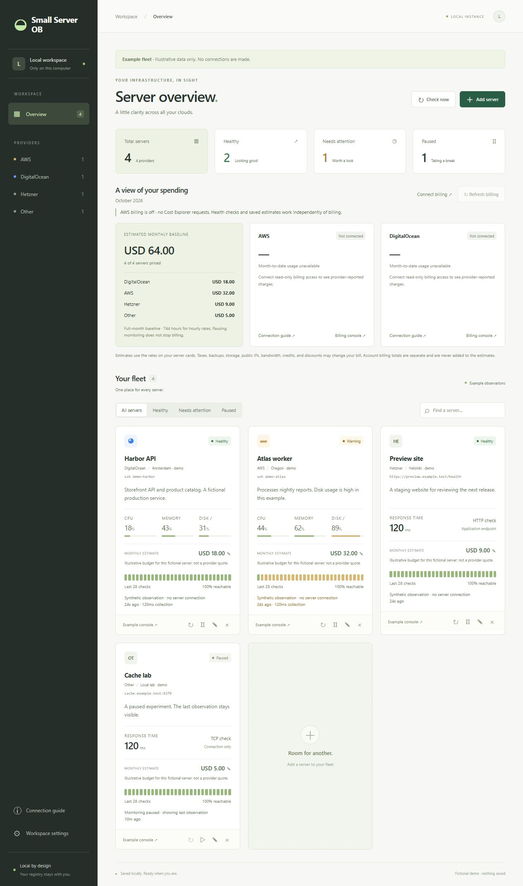
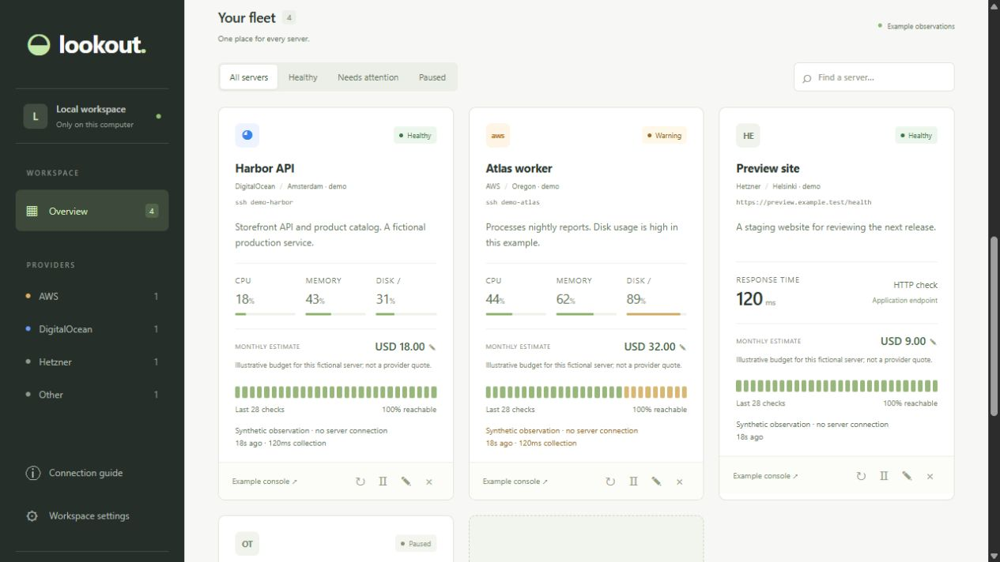
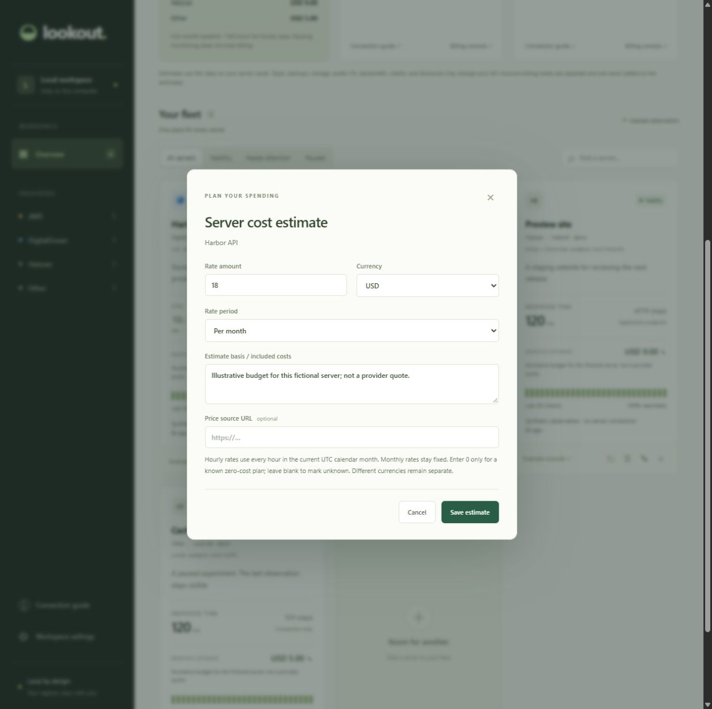

# Lookout

A small, local server observatory. Keep servers from different providers in one calm dashboard, with notes, quick links, health checks, and a persistent local registry.



**All README images use fictional demo data.** No real server names, addresses, notes, metrics, or billing records are included.

## Run locally

Requires **Node.js 22 or newer**. There is no build step. Install the AWS billing SDK dependencies once:

```powershell
cd path/to/server-observatory
npm ci
npm start
```

Open **http://127.0.0.1:4310**. On Windows you can also double-click `start.cmd` or run `./start.ps1`. On Linux, run `./start.sh` (or `sh start.sh` if a ZIP download lost the executable permission). Stop the foreground process with Ctrl+C. The backend only binds to `127.0.0.1`.

See the [Linux setup guide](docs/linux.md) for prerequisites, persistent data, SSH configuration, and moving your registry from Windows.

For a different port, set `PORT` before starting. Set `LOOKOUT_DATA_DIR` to an absolute path to put the registry elsewhere. Relative data paths resolve from your working directory; the default is the project's `data` folder.

## Try the isolated demo

```powershell
npm run demo
```

Open **http://127.0.0.1:4311**. The demo uses an in-memory fictional registry, synthetic checks, and disabled billing. It ignores your real registry, `.env`, configuration file, SSH connections, and cloud credentials. Edits reset when the demo process restarts. This is the supported source for screenshots and documentation recordings.



## Configure and extend

Copy `lookout.config.example.json` to `lookout.config.json` to customize thresholds, polling defaults, check timeouts, concurrency, history retention, server limits, billing cache duration, and UI refresh frequency. Configuration is validated before startup. Existing saved intervals and server timeouts remain authoritative.

- [Configuration reference and precedence](docs/configuration.md)
- [Architecture and extension points](docs/architecture.md)
- [Screenshot testing and privacy workflow](docs/visual-testing.md)

The backend separates HTTP/security, registry operations, health adapters, billing providers, and persistence. The frontend separates rendering, editing, settings, cost controls, and shared utilities. `server.mjs` and `public/app.js` compose these modules. Native ES modules keep the app buildless.

## Add your servers

Choose **Add server**, enter a name, provider, region, purpose/notes, and optional quick links. Provider names are labels, not automatic cloud discovery. Pick a monitoring method:

| Method     | What it measures                                     | Setup                                                                          |
| ---------- | ---------------------------------------------------- | ------------------------------------------------------------------------------ |
| SSH        | CPU activity, memory used, root-filesystem used      | Local OpenSSH and an existing SSH config alias; Linux and Python 3 on the host |
| HTTP/HTTPS | Endpoint status and time to response headers         | A reachable HTTP health endpoint; normal TLS verification                      |
| TCP        | Whether a port accepts a connection; connection time | A reachable hostname/IP and port                                               |

Use **Preview an example fleet** to see the design. All example observations are explicitly synthetic, stay in the browser, and never enter the registry or trigger checks.

### SSH setup

Add a host to your own `~/.ssh/config` (`C:\Users\YOUR_NAME\.ssh\config` on Windows), using your real address and key path:

```sshconfig
Host production-api
  HostName your-server.example.com
  User your-user
  IdentityFile ~/.ssh/your-private-key
```

Run `ssh production-api` yourself, verify the host key against your provider's trusted information, and confirm that `python3` works. Encrypted keys must already be unlocked through your SSH agent. Enter `production-api` in Lookout. A non-root account is sufficient for normal Linux `/proc` reads.

Lookout uses a fixed read-only Python program over standard input. It reads `/proc/stat` twice over 0.4 seconds, `/proc/meminfo`, and root-filesystem usage. It does not install anything, request sudo, accept arbitrary commands, copy keys, or save passwords. It uses noninteractive SSH and strict host-key checking. Existing SSH configuration (including user-configured proxy/jump-host behavior) is trusted local configuration. The displayed SSH duration includes login and collection, **not** just network latency.

### Status meanings (default thresholds)

- **Healthy:** HTTP 2xx / a successful TCP connection under 1.5 seconds, or valid SSH metrics below the thresholds.
- **Warning:** CPU at least 90%, memory or root-disk usage at least 85%; HTTP/TCP response at least 1.5 seconds; or an HTTP redirect. Redirects are not followed; use the final endpoint.
- **Unreachable:** an HTTP/TCP check failed, timed out, or returned an unsuccessful HTTP response. This reflects this computer's ability to reach the service, not proof of a powered-off server.
- **Unknown:** no reading yet, or SSH could not collect valid metrics. Authentication failures never become healthy observations.
- **Stale:** the last reading is older than 2.5 check intervals (minimum 45 seconds), or the dashboard loses its backend connection.
- **Paused:** automatic checks are disabled for the card. Any visible metrics are the last collected values.

By default, the history strip shows the latest 28 checks and the registry keeps up to 60 per server; both limits are configurable. “Reachable” is the share of successful checks in this short sample, excluding unknown checks. It is not time-weighted uptime or a service-level objective. HTTP checks inspect response status, not response-body content.

## Local persistence and operation

- Configurations and recent observations are stored in `data/registry.json`. Writes use a temporary file, flush, and atomic rename. `registry.json.bak` retains the previous snapshot. This folder is ignored by Git.
- A registry lock prevents two app instances writing the same file. If a process crashes, a stale PID lock is recovered on the next launch. An unreadable registry stops startup instead of silently overwriting your settings.
- To restore a backup, stop the app first and copy `registry.json.bak` to `registry.json`. Keep the damaged file if it is useful for recovery.
- Settings include check interval (default 30 seconds). The backend starts polling on launch, limits concurrent checks to four by default, and prevents overlapping check batches. A full round for a large fleet can take longer than the configured interval.
- Closing a browser tab does not stop the Node process. Monitoring stops when the process exits or your computer sleeps; it resumes on launch/wake. There is no always-on remote deployment.
- **Workspace settings → Export registry** exports configurations, notes, and links, excluding SSH credentials and check history. Imports are validated completely before adding records; they append, and may create duplicates. The file contains server addresses and any sensitive notes you chose to add, so keep it private.
- By default, up to 200 manually configured servers and eight quick links per server. The server limit is configurable. Links support HTTP and HTTPS; use a console URL or application URL. Use SSH aliases in your terminal for interactive access.
- The local API rejects foreign Host/Origin headers, cross-site browser requests, and mutations without a per-process token. No remote authentication or multi-user mode is provided.

## Cost estimates and billing

Each server card has an editable monthly estimate. Choose an hourly or monthly rate, a currency, and an explanation of what the estimate includes. The fleet total shows coverage and keeps currencies separate. Unknown rates are excluded and marked as missing; pausing health monitoring does not remove a server from the cost estimate.

**Connect billing** opens the setup guide. Optional read-only adapters retrieve AWS Cost Explorer month-to-date unblended costs and DigitalOcean account usage/balance. They require your own local billing credentials, run only on an explicit refresh, and cache successful results for six hours by default. Health checks and opening the dashboard never query Cost Explorer; billing remains opt-in. Account totals are separate from the server estimates; they are never added together.



See [Costs and billing setup](docs/costs-and-billing.md) for permissions, credential setup, estimate assumptions, and verification limits. A copyable configuration is in `.env.example`.

## AWS and DigitalOcean metrics APIs

Both can supply metrics to a locally running app. **Cloud health-metric adapters and automatic inventory discovery are not implemented in this version.** Billing adapters are available separately. The provider field groups manually configured servers; SSH works across providers.

| Source                      | Available metrics                                          | Guest metrics requirement                                                                                                          |
| --------------------------- | ---------------------------------------------------------- | ---------------------------------------------------------------------------------------------------------------------------------- |
| AWS EC2 / CloudWatch        | CPU utilization, network, disk I/O, instance status checks | Memory and filesystem usage need CloudWatch Agent or another custom publisher; native disk I/O is not filesystem space utilization |
| DigitalOcean Monitoring API | CPU, load, memory, filesystem metrics                      | DigitalOcean's `do-agent` supplies system metrics                                                                                  |
| SSH (implemented)           | Linux CPU, memory, root-filesystem usage                   | Existing SSH access and Python 3; no monitoring agent                                                                              |

Official sources checked on 2026-10-22:

- [AWS EC2 metrics](https://docs.aws.amazon.com/AWSEC2/latest/UserGuide/viewing_metrics_with_cloudwatch.html)
- [CloudWatch Agent metrics](https://docs.aws.amazon.com/AmazonCloudWatch/latest/monitoring/metrics-collected-by-CloudWatch-agent.html)
- [CloudWatch GetMetricData](https://docs.aws.amazon.com/AmazonCloudWatch/latest/monitoring/metrics-classic-getdata.html)
- [DigitalOcean Monitoring API](https://docs.digitalocean.com/products/monitoring/reference/api/)
- [DigitalOcean agent setup](https://docs.digitalocean.com/products/monitoring/getting-started/quickstart/)

A future API adapter should use local AWS credential profiles or a secret-store-backed DigitalOcean token; retain provider timestamps and distinguish missing/stale metrics from healthy readings. AWS native metrics commonly cover 5-minute intervals (1-minute with detailed monitoring), so API polling and freshness differ from direct SSH readings. Check provider permissions and current pricing before enabling cloud calls.

## Development and verification

```powershell
npm run check
npm test
npm run docs:check
npm run repo:check
```

GitLab CI and GitHub Actions run these checks and the test suite on Node.js 22 and 24 after pushes and for merge/pull requests. GitLab shows test results in the pipeline's **Tests** tab; GitHub provides a separate JUnit artifact for each Node.js version. Reports are retained for seven days. Both pipelines use temporary registries, loopback services, and fictional fixtures; they require no server or billing credentials. Launch Lookout on your own computer with `npm start`; these pipelines verify the source and do not deploy the app.

`repo:check` inspects the Git index for private runtime files and common credential patterns. When the local registry exists, it also checks tracked text for known server identifiers. Run it locally after staging changes and before pushing; CI cannot compare against a private registry it never receives. This is a focused guard, not a comprehensive secret scanner.

The integration suite uses temporary registries and real loopback HTTP/TCP endpoints. It checks CRUD/persistence, imports/exports, hostile requests, timeouts, status classification, bounded history, configuration changes during checks, SSH argument safety, and corrupt-registry preservation. Live SSH/cloud connectivity requires your own configured targets; passing local tests does not verify real cloud credentials or hosts.

The tests also cover configuration precedence and limits, adapter injection, billing/health isolation, and a demo process started with deliberately populated private-registry and credential environment variables. The demo still returns only fictional data and never changes the private registry.

Desktop browser interactions and screenshots are recorded in [Visual testing](docs/visual-testing.md). These are manual UI/screenshot checks, not a pixel-diff suite. `npm run docs:check` verifies the reviewed image hashes and scans documentation/demo/UI text for known local server identifiers when a registry is available.

Run `npm run format` to apply the shared formatting rules to source and documentation; private runtime files are excluded. Live SSH/cloud connectivity requires your own configured targets and is not exercised by the demo.
